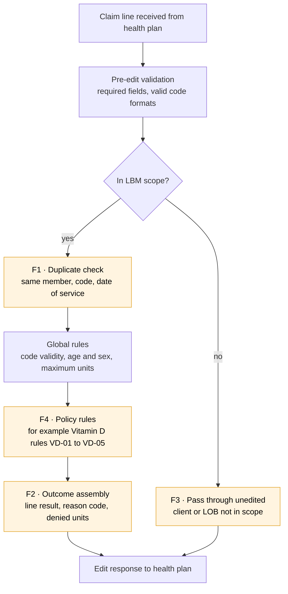

# Configuration Analyst Portfolio — Laboratory Benefits Management

**Ram Akhmitzyanov** · Configuration Analyst candidate · Fort Myers, Florida
arramzis@gmail.com · 517-899-4697 · [LinkedIn](https://www.linkedin.com/in/ram-akhmitzyanov-8479a56b)

I turn clinical and payment policy into claim-editing rules that work, and I prove they work before every release. This portfolio holds six work samples, each tied to one duty in Avalon's Configuration Analyst posting: policy-to-rule translation, use-case design, ReadyAPI regression, SQL reporting, global-rules flow review and requirements management.

> **Note:** Every sample uses an invented policy, invented test data and no real member information. The clinical logic follows common public payer patterns. It is not Avalon's proprietary content, and it is not reproduced from any employer's systems.

## Contents

- [Profile](#profile)
- [Work Sample 1 — From medical policy to configuration rules](#work-sample-1--from-medical-policy-to-configuration-rules)
- [Work Sample 2 — Configuration analysis to regression use cases](#work-sample-2--configuration-analysis-to-regression-use-cases)
- [Work Sample 3 — ReadyAPI regression suite design](#work-sample-3--readyapi-regression-suite-design)
- [Work Sample 4 — SQL reporting for configuration and regression](#work-sample-4--sql-reporting-for-configuration-and-regression)
- [Work Sample 5 — LBM global rules process flow review](#work-sample-5--lbm-global-rules-process-flow-review)
- [Work Sample 6 — Requirements lifecycle, traceability and release readiness](#work-sample-6--requirements-lifecycle-traceability-and-release-readiness)
- [Qualifications mapped to the posting](#qualifications-mapped-to-the-posting)
- [30-60-90 day plan](#30-60-90-day-plan)

## Profile

**Summary.** Ability and Experience in health plan operations / claims configuration / business analysis. Ability and Experience in claims processing, reimbursement, utilization management. Ability to write requirements that developers can build and testers can verify, and I run the workgroups that resolve gaps between them.

**Core skills of different experience**

- Policy-to-rule translation: CPT/HCPCS, ICD-10-CM, modifiers, place of service, frequency and age/sex edits
- Use-case and regression testing: positive, negative, boundary and interaction cases traced to requirements
- ReadyAPI (SoapUI Pro): data-driven test suites, Groovy assertions, environment switching, CLI runs
- SQL (intermediate), Excel (lookups, pivot tables, Power Query) and Access (queries, linked tables)
- Health plan operations: X12 837P claims, edit outcomes (deny, pend, pass), denial reason codes
- Facilitation: requirements sessions, defect triage, release go/no-go

## Work Sample 1 — From medical policy to configuration rules

One policy statement became six testable rules, two open questions and zero ambiguous criteria. The source is an invented Vitamin D testing policy, written the way lab policies usually are: covered indications, exclusions and frequency limits.

**Source policy (illustrative excerpt)**

1. 25-hydroxyvitamin D testing (CPT 82306) is medically necessary for members with a listed indication: chronic kidney disease, osteoporosis or osteomalacia, malabsorption, hypocalcemia, hyperparathyroidism, or monitoring of treated deficiency.
2. Screening of asymptomatic members without a listed indication is not medically necessary.
3. 1,25-dihydroxyvitamin D testing (CPT 82652) is limited to CKD, hypercalcemia, sarcoidosis and parathyroid disorders.
4. No more than 4 units of 82306 per member in a rolling 12 months.
5. 82652 with 82306 on the same date of service needs a supporting 82652 indication.

**Translation into rules**

| Rule ID | Type | Codes | Condition | Action | Reason |
| --- | --- | --- | --- | --- | --- |
| VD-01 | Diagnosis inclusion | 82306 | No diagnosis on claim line in value set `VD_25OH_DX` | Deny | Not medically necessary: no covered indication |
| VD-02 | Diagnosis exclusion | 82306 | Only diagnoses are screening codes (Z13.21, Z13.89, Z00.00, Z00.01) | Deny | Screening not covered |
| VD-03 | Diagnosis inclusion | 82652 | No diagnosis in value set `VD_125_DX` | Deny | Not medically necessary: no covered indication |
| VD-04 | Frequency | 82306 | Units for member in rolling 365 days, this line included, > 4 | Deny excess units | Frequency limit exceeded |
| VD-05 | Same-day combination | 82652 + 82306 | Both on same DOS, same member, and VD-03 not satisfied | Deny 82652 | Not medically necessary with 82306 |
| VD-06 | Pass-through | 82306, 82652 | All rules satisfied | Pass | — |

**Value sets (abridged)**

| Value set | ICD-10-CM codes or ranges | Clinical meaning |
| --- | --- | --- |
| `VD_25OH_DX` | N18.1–N18.9, M80.–M81.8, M83.–, K90.–, E83.51, E21.0–E21.5, E55.9 | CKD, osteoporosis, osteomalacia, malabsorption, hypocalcemia, hyperparathyroidism, deficiency |
| `VD_125_DX` | N18.1–N18.9, E83.52, D86.–, E20.–, E21.– | CKD, hypercalcemia, sarcoidosis, parathyroid disorders |

**Example rule definition (generic format)**

The real configuration file format is Avalon's own. This shows the fields every rule needs, whatever the syntax.

```json
{
  "ruleId": "VD-04",
  "policyRef": "LAB-VITD-001 §4",
  "effectiveFrom": "2027-01-01",
  "effectiveTo": null,
  "procedureCodes": ["82306"],
  "logic": {
    "type": "FREQUENCY",
    "scope": "MEMBER",
    "window": { "unit": "DAYS", "length": 365, "rolling": true },
    "maxUnits": 4,
    "includeHistory": ["PAID", "PENDED"]
  },
  "action": "DENY_EXCESS_UNITS",
  "reasonCode": "LBM-FREQ-001",
  "lineOfBusiness": ["COMMERCIAL", "MEDICARE_ADV", "MEDICAID"]
}
```

**Questions logged with the policy owner before build**

- [ ] VD-04: does the rolling window count denied history lines, or only paid and pended ones? (Assumed: paid and pended.)
- [ ] VD-02: if a screening code is primary and a covered code is secondary, does the line pass? (Assumed: yes. Any covered diagnosis on the line satisfies VD-01.)
- [ ] Effective date: date of service or date received? (Assumed: date of service.)

**What this shows:** each policy sentence maps to a rule with an ID, a trigger, an action and a reason code. Every assumption is written down and sent to its owner instead of being decided silently in configuration.

## Work Sample 2 — Configuration analysis to regression use cases

Six rules produced 14 use cases, and every rule is covered by at least one passing case and one failing case. I build the cases from three techniques. Decision tables cover combinations of conditions. Boundary values cover counts and dates. Equivalence classes keep the suite small, so one representative code stands in for each value set range.

**Use-case matrix (Vitamin D rules)**

| TC ID | Rule | Type | Scenario | Claim input | Expected result |
| --- | --- | --- | --- | --- | --- |
| VD-TC-01 | VD-01 | Positive | Covered indication | 82306 × 1, dx N18.3, no history | Pass |
| VD-TC-02 | VD-01 | Negative | No covered indication | 82306 × 1, dx R53.83 | Deny, no covered indication |
| VD-TC-03 | VD-02 | Negative | Screening only | 82306 × 1, dx Z13.21 | Deny, screening |
| VD-TC-04 | VD-02 | Interaction | Screening + covered dx | 82306 × 1, dx Z13.21 + M81.0 | Pass |
| VD-TC-05 | VD-03 | Positive | 1,25 with sarcoidosis | 82652 × 1, dx D86.0 | Pass |
| VD-TC-06 | VD-03 | Negative | 1,25 with osteoporosis only | 82652 × 1, dx M81.0 | Deny, no covered indication |
| VD-TC-07 | VD-04 | Boundary | 4th unit in window | 82306 × 1, dx E55.9, 3 paid in last 365 days | Pass |
| VD-TC-08 | VD-04 | Boundary | 5th unit in window | 82306 × 1, dx E55.9, 4 paid in last 365 days | Deny 1 unit, frequency |
| VD-TC-09 | VD-04 | Boundary | Oldest service falls off | 82306 on day 366 after earliest of 4 paid | Pass |
| VD-TC-10 | VD-04 | Boundary | Multi-unit line crosses limit | 82306 × 2, 3 paid in window | Pass 1 unit, deny 1 unit |
| VD-TC-11 | VD-04 | Negative | Denied history ignored | 82306 × 1, 4 denied + 0 paid in window | Pass |
| VD-TC-12 | VD-05 | Interaction | Same day, 82652 unsupported | 82306 + 82652 same DOS, dx N18.3 on 82306 only | Pass 82306, deny 82652 |
| VD-TC-13 | VD-05 | Positive | Same day, both supported | 82306 + 82652 same DOS, dx N18.4 on both | Pass both |
| VD-TC-14 | Effective date | Boundary | DOS before rule start | 82306, dx R53.83, DOS 2026-12-31 | Pass, rule not yet active |

**Regression scope when the configuration changes**

I do not rerun everything blindly, and I do not rerun only the changed rule. For each change I trace impact through three questions:

1. Which rules share a procedure code, value set or reason code with the changed rule?
2. Which global rules run before or after it in the edit sequence (for example, member eligibility or duplicate checks)?
3. Which clients or lines of business have overrides on the affected codes?

The answer sets the targeted suite. A full-suite run still happens before every production release of the Claim Editor.

**Test data rules**

- Synthetic members only, with IDs in a reserved test range
- Claim history seeded by a setup step, so tests do not depend on what is in the environment
- One fact under test per case. Everything else on the claim is set to values known to pass.

## Work Sample 3 — ReadyAPI regression suite design

The suite is data-driven: adding a use case means adding a row to a spreadsheet, not building a new test step. Business analysts can then own the cases, and the suite grows with each policy without growing its maintenance cost.

**Project structure**

```text
ClaimEditor_Regression.xml
├── Environments: DEV · QA · UAT  (endpoint + auth per environment)
├── Suite 00_Smoke            -> health check, one pass and one deny claim
├── Suite 10_GlobalRules      -> eligibility, duplicates, invalid codes, timely filing
├── Suite 20_Policy_VitaminD  -> one test case per policy
│   ├── Setup: seed claim history for test members
│   ├── DataSource: VitaminD_cases.xlsx (one row per TC ID)
│   ├── REST Request: POST /claims/edit   (body built from row values)
│   ├── Assertions: HTTP 200 · schema · Groovy outcome check
│   ├── DataSink: results row (TC ID, expected, actual, status)
│   └── DataSource Loop -> back to REST Request
├── Suite 2x_Policy_...       -> same pattern for each policy
└── Suite 99_Teardown         -> remove seeded history
```

**Data source columns**

| Column | Example | Use |
| --- | --- | --- |
| `TC_ID` | VD-TC-08 | Ties the result back to the use-case matrix |
| `MemberId` | TST000108 | Synthetic member with seeded history |
| `DOS` | 2027-03-15 | Date of service |
| `CPT` | 82306 | Procedure code |
| `Units` | 1 | Units billed |
| `DxCodes` | E55.9 | Pipe-separated diagnosis list |
| `ExpectedOutcome` | DENY | PASS, DENY or PARTIAL |
| `ExpectedReason` | LBM-FREQ-001 | Reason code checked when the outcome is DENY |
| `ExpectedDeniedUnits` | 1 | Checked for frequency rules |

**Request template (property expansion from the data source)**

```json
{
  "claimId": "REG-${DataSource#TC_ID}-${=System.currentTimeMillis()}",
  "memberId": "${DataSource#MemberId}",
  "lines": [{
    "lineNumber": 1,
    "dateOfService": "${DataSource#DOS}",
    "procedureCode": "${DataSource#CPT}",
    "units": ${DataSource#Units},
    "diagnosisCodes": "${DataSource#DxCodes}"
  }]
}
```

**Groovy script assertion: compare actual to expected**

```groovy
import groovy.json.JsonSlurper

def body = new JsonSlurper().parseText(messageExchange.responseContent)
def line = body.lines[0]

def tcId           = context.expand('${DataSource#TC_ID}')
def expOutcome     = context.expand('${DataSource#ExpectedOutcome}')
def expReason      = context.expand('${DataSource#ExpectedReason}')
def expDeniedUnits = context.expand('${DataSource#ExpectedDeniedUnits}')

assert line.outcome == expOutcome :
    "${tcId}: expected ${expOutcome}, got ${line.outcome} (${line.reasonCode})"

if (expOutcome in ['DENY', 'PARTIAL']) {
    assert line.reasonCode == expReason :
        "${tcId}: expected reason ${expReason}, got ${line.reasonCode}"
}
if (expDeniedUnits) {
    assert line.deniedUnits == expDeniedUnits.toInteger() :
        "${tcId}: expected ${expDeniedUnits} denied units, got ${line.deniedUnits}"
}
```

Each failure message names the TC ID, the expected value and the actual value, so a reviewer can triage without opening the raw response.

**Running before a release**

```bash
testrunner.sh -E"QA" -r -j -f"reports/2027-01-release" ClaimEditor_Regression.xml
```

The JUnit output feeds the release record. A run passes only when every case passes, or when each failure is linked to an accepted, documented change in expected behavior.

**Maintenance rules I apply**

- One test case per policy; cases live in data, not in steps
- No hard-coded endpoints or credentials. Everything comes from environment properties
- Each expected result changed in a release is reviewed and linked to its change ticket
- Retired policies are moved to an archive suite, not deleted, so history stays auditable

## Work Sample 4 — SQL reporting for configuration and regression

Four queries answer the questions a configuration team gets asked most. Is every rule tested? What changed between runs? Is a new rule behaving in production? Does the engine count frequency the way the policy says? The schema below is a simplified model I wrote for these samples (SQL Server syntax).

```text
config_rule      (rule_id, policy_ref, rule_type, effective_from, effective_to, status)
test_case        (tc_id, rule_id, case_type, active_flag)
test_run         (run_id, release_label, environment, run_ts)
test_result      (run_id, tc_id, expected_outcome, actual_outcome, status)
claim_line_edit  (claim_id, line_no, member_id, dos, cpt, units, outcome,
                  denied_units, rule_id, reason_code, client_id, processed_ts)
```

**1. Coverage gaps: active rules with no failing-path test case**

```sql
SELECT r.rule_id,
       r.policy_ref,
       r.rule_type,
       COUNT(t.tc_id)                                            AS total_cases,
       SUM(CASE WHEN t.case_type IN ('Negative','Boundary') THEN 1 ELSE 0 END) AS failing_path_cases
FROM   config_rule r
LEFT JOIN test_case t
       ON t.rule_id = r.rule_id
      AND t.active_flag = 1
WHERE  r.status = 'ACTIVE'
  AND  (r.effective_to IS NULL OR r.effective_to >= CAST(GETDATE() AS date))
GROUP BY r.rule_id, r.policy_ref, r.rule_type
HAVING SUM(CASE WHEN t.case_type IN ('Negative','Boundary') THEN 1 ELSE 0 END) = 0
ORDER BY r.policy_ref, r.rule_id;
```

**2. Run-over-run changes: cases whose actual outcome moved between two releases**

```sql
WITH prior_run AS (
    SELECT tc_id, actual_outcome, status FROM test_result WHERE run_id = @prior_run_id
), current_run AS (
    SELECT tc_id, actual_outcome, status FROM test_result WHERE run_id = @current_run_id
)
SELECT c.tc_id,
       tc.rule_id,
       p.actual_outcome AS prior_outcome,
       c.actual_outcome AS current_outcome,
       c.status         AS current_status
FROM   current_run c
JOIN   test_case tc   ON tc.tc_id = c.tc_id
LEFT JOIN prior_run p ON p.tc_id = c.tc_id
WHERE  p.tc_id IS NULL                       -- new case
   OR  p.actual_outcome <> c.actual_outcome  -- behavior changed
   OR  c.status = 'FAIL'
ORDER BY c.status DESC, tc.rule_id, c.tc_id;
```

Every row returned needs one of two answers before go-live: "expected, linked to change ticket" or "defect."

**3. Post-release monitoring: weekly deny rate by rule, flagging jumps**

```sql
WITH weekly AS (
    SELECT rule_id,
           DATEADD(week, DATEDIFF(week, 0, processed_ts), 0) AS week_start,
           COUNT(*)                                          AS lines_hit,
           SUM(CASE WHEN outcome = 'DENY' THEN 1 ELSE 0 END) AS lines_denied
    FROM   claim_line_edit
    WHERE  processed_ts >= DATEADD(week, -8, GETDATE())
      AND  rule_id IS NOT NULL
    GROUP BY rule_id, DATEADD(week, DATEDIFF(week, 0, processed_ts), 0)
), rates AS (
    SELECT *,
           CAST(lines_denied AS decimal(10,4)) / NULLIF(lines_hit, 0) AS deny_rate,
           LAG(CAST(lines_denied AS decimal(10,4)) / NULLIF(lines_hit, 0))
               OVER (PARTITION BY rule_id ORDER BY week_start)          AS prior_deny_rate
    FROM   weekly
)
SELECT rule_id, week_start, lines_hit, lines_denied, deny_rate, prior_deny_rate
FROM   rates
WHERE  prior_deny_rate IS NOT NULL
  AND  lines_hit >= 50
  AND  ABS(deny_rate - prior_deny_rate) >= 0.10
ORDER BY week_start DESC, ABS(deny_rate - prior_deny_rate) DESC;
```

The 50-line floor and the 10-point threshold are starting values. I would tune them with the team once real volumes are known.

**4. Independent check of the frequency rule (VD-04)**

This recomputes rolling 365-day units outside the engine. Any line where the engine and the query disagree is a defect candidate.

```sql
WITH lines AS (
    SELECT claim_id, line_no, member_id, dos, units, outcome, denied_units
    FROM   claim_line_edit
    WHERE  cpt = '82306'
      AND  outcome IN ('PASS','PARTIAL','DENY')
), counted AS (
    SELECT l.*,
           ( SELECT COALESCE(SUM(h.units - COALESCE(h.denied_units, 0)), 0)
             FROM   lines h
             WHERE  h.member_id = l.member_id
               AND  h.dos >  DATEADD(day, -365, l.dos)
               AND  h.dos <= l.dos
               AND  (h.dos < l.dos OR (h.dos = l.dos AND h.claim_id < l.claim_id))
               AND  h.outcome IN ('PASS','PARTIAL') ) AS prior_allowed_units
    FROM   lines l
)
SELECT claim_id, line_no, member_id, dos, units, prior_allowed_units,
       CASE WHEN prior_allowed_units >= 4 THEN units
            WHEN prior_allowed_units + units > 4 THEN prior_allowed_units + units - 4
            ELSE 0 END                       AS expected_denied_units,
       COALESCE(denied_units, 0)             AS engine_denied_units
FROM   counted
WHERE  COALESCE(denied_units, 0) <>
       CASE WHEN prior_allowed_units >= 4 THEN units
            WHEN prior_allowed_units + units > 4 THEN prior_allowed_units + units - 4
            ELSE 0 END;
```

The same logic, as an Access query or an Excel pivot, gives non-technical reviewers a way to check the numbers themselves.

## Work Sample 5 — LBM global rules process flow review

A review of the edit sequence found four gaps. Each one could produce a wrong or unexplained outcome without any single rule being misconfigured. The flow below is my model of a typical lab-benefits edit sequence, not Avalon's internal design. The method carries over to the real one.



*Every claim line clears scope, duplicate and global checks before policy rules. F1–F4 mark the review findings below.*

The review walks each line type through the flow and asks, at every step, "what happens to the next step if this one passes, fails or is skipped?"

| ID | Where | Finding | Risk | Recommendation |
| --- | --- | --- | --- | --- |
| F1 | Duplicate check → policy rules | Frequency rules may count claim history before exact duplicates are removed | A duplicate submission inflates the count and triggers a false frequency denial | Exclude lines denied as duplicates from frequency history. Add a regression case: duplicate + 4th unit |
| F2 | Outcome assembly | No documented precedence when one line hits several deny rules | Reason code varies between runs, and appeals and provider notices become inconsistent | Define a rule precedence order (global before policy, then by rule ID). Assert the reason code in every deny case |
| F3 | Scope decision | Out-of-scope pass-through has no regression case | A scope configuration error would silently edit claims for a client or line of business that is not delegated | Add one pass-through case per client and line of business to the smoke suite |
| F4 | Policy rules | Effective date basis (date of service or received date) not stated for policy rules | Claims around a policy start date are edited inconsistently | Confirm date-of-service basis. Add boundary cases on the day before and the day of the effective date |

Each finding goes to the configuration manager as a proposed change with a test case attached, so the fix and its proof ship together.

## Work Sample 6 — Requirements lifecycle, traceability and release readiness

A requirement is only finished when it traces from policy sentence to rule to test case to a passing result. Below is the trace for the Vitamin D work, the release checklist I run against it, and the way I run the meetings that hold it together.

**Traceability matrix (excerpt)**

| Requirement | Policy source | Rule | Test cases | Last result | Change ticket |
| --- | --- | --- | --- | --- | --- |
| REQ-VD-01 Deny 82306 without covered indication | LAB-VITD-001 §1 | VD-01 | TC-01, TC-02 | Pass | CHG-0000 |
| REQ-VD-02 Deny screening-only 82306 | §2 | VD-02 | TC-03, TC-04 | Pass | CHG-0000 |
| REQ-VD-03 Restrict 82652 indications | §3 | VD-03 | TC-05, TC-06 | Pass | CHG-0000 |
| REQ-VD-04 Limit 82306 to 4 units in 12 months | §4 | VD-04 | TC-07 to TC-11 | Pass | CHG-0000 |
| REQ-VD-05 Same-day 82652 needs own indication | §5 | VD-05 | TC-12, TC-13 | Pass | CHG-0000 |

**Lifecycle I follow**

1. **Intake.** Read the policy translation document, list every criterion, and log ambiguities with the clinical or policy owner.
2. **Requirements.** Write one testable requirement per criterion: trigger, action, reason code, effective date and client scope.
3. **Review.** Walk through the requirements with policy, configuration and QA in one session, and record decisions in the log.
4. **Build.** Configure the rules, then peer-review the configuration against the requirement (four-eyes check).
5. **Test.** Run the targeted cases, then the full regression suite, and triage each failure as defect, data issue or expected change.
6. **Release.** Hold go/no-go with evidence: run report, open defects and their severity, sign-offs.
7. **Monitor.** Watch deny rates for 2 to 4 weeks after release (Sample 4, query 3), and close the loop with the policy owner.

**Release readiness checklist**

- [ ] Every new or changed rule has at least one positive case and one negative or boundary case
- [ ] Full regression run on the release build, report attached
- [ ] Every outcome change traced to a ticket, or logged as a defect
- [ ] No open severity-1 or severity-2 defects
- [ ] Effective dates and client overrides verified in the configuration file
- [ ] Rollback plan confirmed with the release owner
- [ ] Sign-off from configuration manager and policy owner

**Facilitating across groups**

- **Defect triage:** a 30-minute standing slot during test windows. Each defect gets an owner and a target date before the meeting ends.
- **Disagreements on intent:** I bring the policy sentence, the rule as built and the failing case side by side. The decision goes back into the requirement, not just the configuration.
- **Status:** one page per release covering scope, test progress, open risks and decisions needed, sent on a fixed day each week.

## Qualifications mapped to the posting

| Posting requirement | Evidence in this portfolio |
| --- | --- |
| Analyze LBM configuration to create use cases for regression testing | Sample 2 |
| Turn medical policy translation documents into configuration rules | Sample 1 |
| Run regression testing before Claim Editor production releases | Samples 2, 3, 6 |
| Build and maintain a ReadyAPI regression suite | Sample 3 |
| Validate or give input on LBM global rules process flows | Sample 5 |
| 3+ years managing business requirements through a project lifecycle | Sample 6 |
| Health care business and customer service | Samples 1, 5 |
| Intermediate Excel and Access | Samples 4, 6 |
| Use case testing | Sample 2 |
| 1–2 years reporting, intermediate SQL | Sample 4 |
| Health plan configuration, utilization, claims or reimbursement | Samples 1, 4, 5 |
| Translate business needs into application requirements | Samples 1, 6 |
| Workgroup facilitation and cross-group problem resolution | Sample 6 |

## 30-60-90 day plan

By day 90 I would own regression for at least one policy area end to end, from translation document to production monitoring.

**Days 1–30: learn the system and the people**

- Learn the LBM configuration file structure, rule types and global rules sequence
- Shadow one full release cycle: translation, build, regression, go/no-go
- Run the existing ReadyAPI suite on my own and document anything unclear
- Meet the policy, clinical, QA and client teams that feed configuration

**Days 31–60: contribute under review**

- Translate one or two policy documents into rules, with peer review
- Write their use cases and add them to the ReadyAPI suite as data rows
- Build a coverage-gap report (Sample 4, query 1) for the current suite and share it with my manager

**Days 61–90: own a slice**

- Run pre-release regression for one release and present results at go/no-go
- Propose one improvement to the suite or the global rules flow, with evidence
- Set up post-release deny-rate monitoring for the rules I delivered
